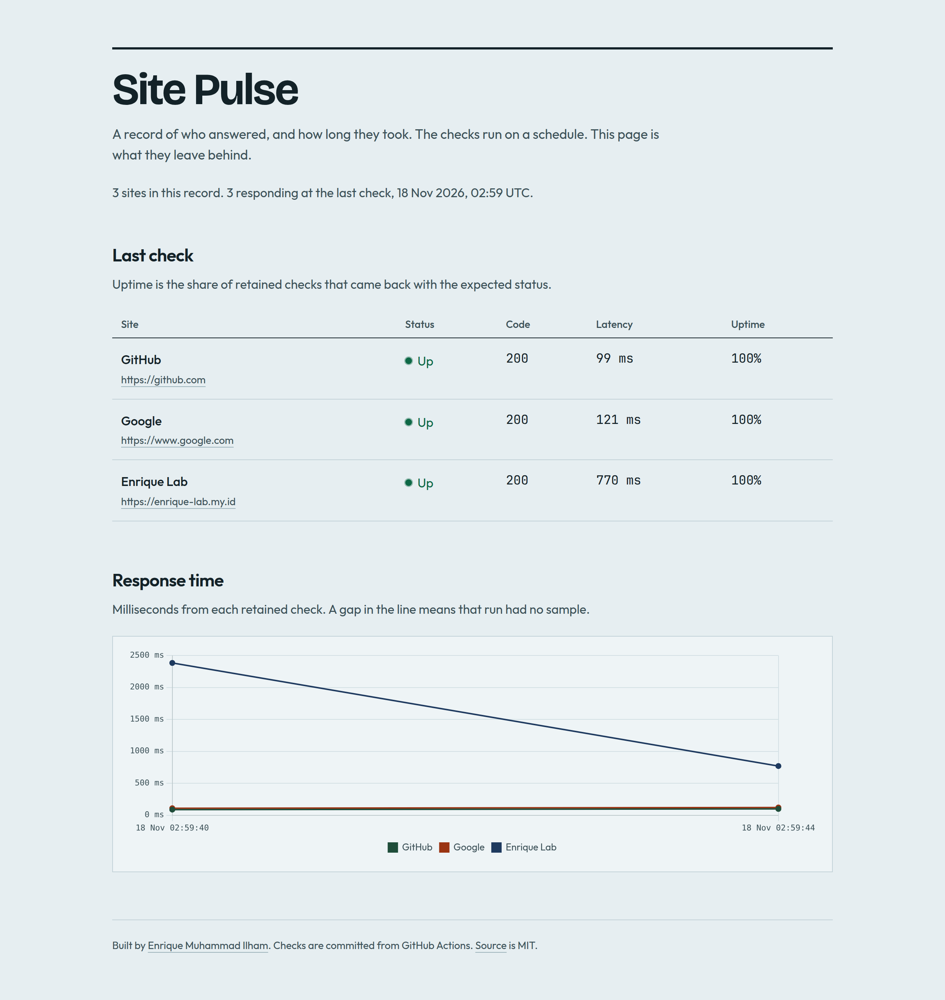
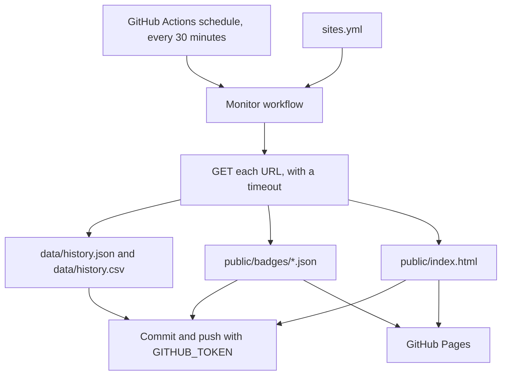

# Site Pulse

A lightweight uptime and response-time monitor that runs on a schedule in GitHub Actions. There is no server to host. Each run requests the sites in [`sites.yml`](sites.yml), appends the result to the repository, and republishes a static status page.

[](https://github.com/EnriqueMuhammad/site-pulse/actions/workflows/ci.yml)
[](LICENSE)
[](https://nodejs.org/)
[](https://github.com)
[](https://www.google.com)
[](https://enrique-lab.my.id)
[](https://enriquemuhammad.github.io/site-pulse/)

The status badges read JSON committed on `main`. They stay blank until this project is on the default branch. Shields caches them for a few minutes after each check.



## How it works



`npm run check` loads the config, requests every site with Node's built-in `fetch`, and cancels the body as soon as the status line is in. A site is up only when the final status, after redirects, matches `expect`. Timeouts and network errors are down results, not crashes. The run is appended to history, old runs past `retention` are dropped, and the command rewrites:

| Path | What it is |
| --- | --- |
| `data/history.json` | One object per run. This is the source the page is built from. |
| `data/history.csv` | The same samples, one row per site, for a spreadsheet. |
| `public/index.html` | Status page. Tailwind and Chart.js load from CDNs. The samples are embedded, so the page does not need an API. |
| `public/badges/<slug>.json` | [Shields.io endpoint](https://shields.io/badges/endpoint-badge) payload: `up 99ms`, `down`, or `no data`. |
| `public/badges/site-pulse.json` | How many configured sites were up on the latest check. |

The [Monitor workflow](.github/workflows/monitor.yml) runs that command every 30 minutes and on demand, commits `data/` and `public/` as `github-actions[bot]`, and deploys `public/` with the official Pages actions. It uses `GITHUB_TOKEN` only. Pushes made with that token do not start another workflow, so a check does not check itself.

GitHub can start a scheduled run later than the cron expression. The history timestamp is when the check actually ran.

## Use it for your own sites

1. Fork the repository.
2. On the fork, open **Settings → Actions → General → Workflow permissions** and choose **Read and write permissions**. The monitor commits history. A read-only token cannot.
3. Open **Settings → Pages → Build and deployment** and set **Source** to **GitHub Actions**. Until you do, the deploy job fails and the status page has no URL.
4. If `main` is protected, allow `github-actions[bot]` to push. Otherwise the commit step is rejected. The bot's email is `41898282+github-actions[bot]@users.noreply.github.com`.
5. Edit [`sites.yml`](sites.yml). Change `repository` to your fork, then list each site with a name, an `http` or `https` URL, and the status you expect.
6. Open **Actions → Monitor → Run workflow**. Forks do not run scheduled workflows until Actions is enabled, and the first cron slot can take a while. A manual run writes the first samples immediately.
7. In this README, replace `EnriqueMuhammad` in the badge URLs and the Pages link. A project site is served at `https://<user>.github.io/site-pulse/`.

```yaml
timeoutMs: 10000
retention: 336
repository: https://github.com/your-name/site-pulse

sites:
  - name: GitHub
    url: https://github.com
    expect: 200
```

`timeoutMs` is an integer from 100 to 60000. `retention` is how many runs to keep, from 1 to 5000. The default, 336, is a week of checks every 30 minutes. Names become badge filenames (`Enrique Lab` → `enrique-lab.json`). `expect` defaults to 200.

## Local use

Node.js 22 or newer. The project is ES modules and uses the test runner and `fetch` that ship with Node.

```bash
npm ci
npm test
npm run lint
npm run check
npm run render
```

`check` talks to the network and writes `data/` and `public/`. `render` rebuilds the page and badges from history already on disk, which is what CI compares against the committed files. `npm run screenshot` needs Chrome and rewrites [`docs/status-page.png`](docs/status-page.png).

```bash
node src/cli.js check --config sites.yml --history data/history.json --csv data/history.csv --out public
node src/cli.js --help
```

A down site still exits 0. The run was recorded. A missing or invalid config exits 1.

## Layout

```
sites.yml                 sites, timeout, and how much history to keep
src/                      config, checks, history, badges, page, CLI
test/                     node:test
scripts/screenshot.js     headless Chrome capture of public/index.html
.github/workflows/ci.yml  tests and lint on push and pull request
.github/workflows/monitor.yml
data/                     committed check history
public/                   status page and badge JSON
docs/status-page.png
```

## License

MIT. Copyright 2026 [Enrique Muhammad Ilham](https://enrique-lab.my.id).
